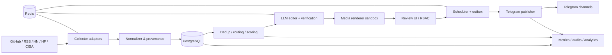
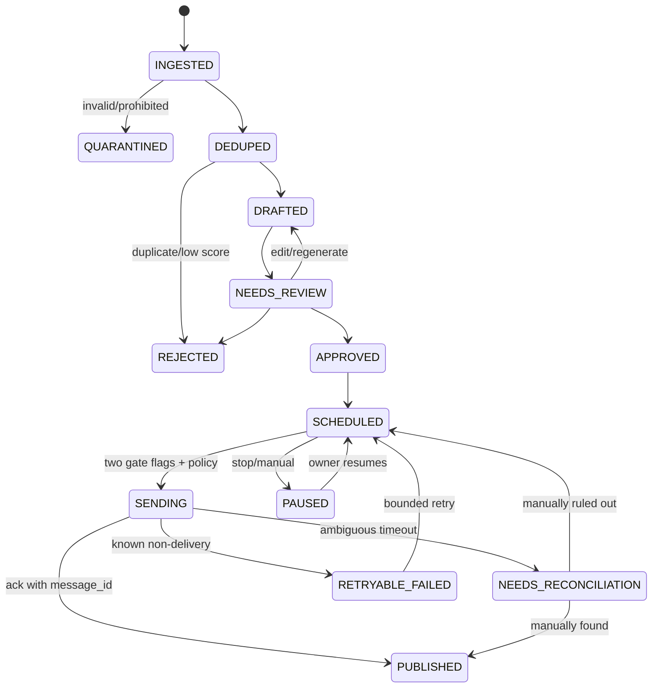

# 02. Архитектура, контракты и данные

## 2.1 Компоненты



Весь контент от источников — недоверенный. Между сборщиком и LLM — нормализованное структурированное представление, а не сырые страницы как инструкции. Между LLM и Bot API — обязательный deterministic validator.

### Сервисы в одном Compose

- `api`: FastAPI, UI/API, авторизация, RBAC, только localhost/private;
- `collector`: фоновые `Dramatiq` задачи ingest, версии адаптеров;
- `editor`: подготовка drafts, проверка подтверждения и fallback при сбоях inference;
- `renderer`: генерация HTML/Pillow; отдельный отключаемый Playwright worker с жесткой сетевой изоляцией;
- `scheduler`: **ровно один leader** с DB advisory lock, выдаёт задания `outbox`, использует UTC, сериализацию channel_id;
- `publisher`: only Bot API outbound, отдельная сетевой ACL, не знает токенов от внешних источников;
- `postgres`: системная запись и история;
- `redis`: ephemeral task broker/cache, не источник истины;
- `metrics`: Prometheus metrics endpoint только для локального мониторинга, JSON logging.

Минимальные привилегии: у `publisher` только Telegram bot token, у `collector` только read-only токены источников, у `editor` только inference access, никакой сборщик не видит GitLab/SSH/PVE.

## 2.2 Структура будущего репозитория

```text
app/
  api/{auth,channels,sources,candidates,posts,approvals,analytics,health}.py
  adapters/{base,github,hackernews,huggingface,arxiv,cisa,cloudflare,k8s,pypi}.py
  pipeline/{normalize,canonicalize,dedup,rank,route,verify,draft}.py
  media/{renderer,templates,remote_images}.py
  publishing/{scheduler,telegram,outbox,reconcile}.py
  core/{config,security,logging,db,models,schemas}.py
  ui/
alembic/versions/
tests/{unit,integration,e2e,security,fixtures}/
configs/
docker/
scripts/
reports/
```

Строго отделить адаптеры источников от бизнес-логики, чтобы замена API не влияла на очередь/карточки.

## 2.3 Модель данных (первоначальный логический уровень)

| Таблица | Основные поля | Инварианты |
|---|---|---|
| `sources` | id, kind, base_url, poll_interval, enabled, tos_note, health, last_success, etag | URL allowlist; source status tracked |
| `source_items` | id, source_id, external_id, discovered_utc, published_utc, raw_hash, raw_json, fetched_utc | `unique(source_id, external_id, raw_hash)`; raw retained 30d |
| `stories` | id, canonical_url, canonical_hash, cluster_id, published_utc, summary, status, provenance | dedup global; bad URLs quarantined |
| `story_evidence` | story_id, claim_id, source_item_id, evidence_excerpt, verified_at, status | every factual claim has source/evidence |
| `classifications` | story_id, channel_id, confidence, reason, is_primary | only one primary by default |
| `score_events` | story_id, rubric_version, per_axis_scores, total, source_data | immutable score history |
| `posts` | id, story_id, channel_id, type, title, body, alt_text, draft_version, review_status, final_hash | edited versions and provenance preserved |
| `media_assets` | id, post_id, kind, file_path, rights_basis, sha256, width, height, bytes, status | no unlicensed remote image reuse |
| `approval_events` | post_id, actor_id, action, reason, before_hash, after_hash, timestamp | append only |
| `publishing_outbox` | id, post_id, channel_id, due_utc, idempotency_key, state, lease, attempts, last_error | unique idempotency; no blind retry |
| `published_messages` | post_id, channel_id, telegram_message_id, published_utc, telegram_link, caption_hash | unique (post_id, channel_id) and (channel_id, message_id) |
| `credentials_refs` | service, secret_ref, created_utc, rotated_utc | secret values NEVER stored in DB |
| `analytics_daily` | channel_id, date, subscribers, posts, clicks_measured, views_manual, costs_actual | source and measurement type per metric |
| `ad_campaigns` | id, advertiser, channel_id, price, period, marked, erid, legal_status, approvals | legal_status must be approved before schedule |
| `users`, `roles`, `sessions` | audit IDs, password hashes/OIDC identifiers, MFA state | least privilege |
| `audit_events` | id, actor, action, entity, entity_id, result, UTC, trace_id, payload_redacted | append-only; log access |

Производственные индексы: `(source_id, external_id)`, `(canonical_hash)`, `(channel_id,status,due_utc)`, `(cluster_id)`, `(post_id, draft_version)`, `(source_id,fetched_utc)`. Postgres partial unique index для единственного активного outbound на `(post_id, channel_id)`. Публичные данные — только краткие выдержки, а не полные статьи.

## 2.4 Контракт из адаптера

`source_item` валидируется JSON Schema `schemas/source_item.schema.json`. Обязательные поля: `source`, `source_external_id`, `source_url`, `title`, `first_seen_at`, `facts[]`, `license_state`, `raw_sha256`. Дата публикации может быть `null`, но неопределённая дата явно снижает свежесть. У каждого `fact` свой `evidence_url` и `evidence_excerpt` (коротко).

`post` по `schemas/post_draft.schema.json`: заголовок, один основной канал, тип, тело до 900 видимых символов с запасом, утверждённые URLs, warnings, label `research_preprint` / `unverified` / `sponsored`. `telegraph_media` запрещено использовать как fallback: неподтверждённые media URL не отправлять.

## 2.5 Публичный REST API — только через авторизацию

| Метод | Путь | Право | Эффект |
|---|---|---|---|
| GET | `/api/v1/channels` | VIEWER | список, график, enabled |
| GET | `/api/v1/stories?state=&channel=` | VIEWER | фильтр кандидатов и дублей |
| GET | `/api/v1/stories/{id}` | VIEWER | факты, источники, score, риск |
| POST | `/api/v1/stories/import-url` | EDITOR | добавить URL через safe fetch/allowlist |
| POST | `/api/v1/posts/{id}/regenerate` | EDITOR | новая версия draft/media, без публикации |
| PATCH | `/api/v1/posts/{id}` | EDITOR | сохранить с optimistic lock/version |
| POST | `/api/v1/posts/{id}/approve` | EDITOR / REVIEWER_SECURITY | approval, conditional high-risk |
| POST | `/api/v1/posts/{id}/reject` | EDITOR | запрет публикации с причиной |
| POST | `/api/v1/posts/{id}/schedule` | EDITOR | только approved и разрешённая политика |
| POST | `/api/v1/posts/{id}/publish` | OWNER | после глобальных и канальных gate |
| POST | `/api/v1/publishing/{id}/reconcile` | OWNER | reconcile ambiguous sends |
| POST | `/api/v1/channels/{id}/pause` | OWNER | stop future sends |
| GET | `/api/v1/metrics` | VIEWER | контролируемая статистика |
| GET | `/health/live`, `/health/ready` | private | health/readiness |

Все mutating методы требуют CSRF защиты для cookie-based auth, audit event, Idempotency-Key где применимо и `If-Match` для версии. OAS Swagger не публичный, security policy единая.

## 2.6 State machine



**Ключевой edge case**: HTTP request отправлен в Telegram, но ответ потерян. Это НЕ ошибка с известной неотправкой. Нельзя автоматически повторить; указать состояние ambiguous и предложить сверить с каналом. При crash между успешной отправкой и DB commit — также `NEEDS_RECONCILIATION`.

## 2.7 Идемпотентность и конкурентность

- `idempotency_key=sha256(channel_id + post_id + approved_draft_version + publish_intent_id)`, не создавать новый intent при retry.
- Redis lock недостаточен: DB transactional claims с `FOR UPDATE SKIP LOCKED` и lease/heartbeat.
- У `scheduler` singleton leader + журнал next_due; после reboot не догонять автоматически весь просроченный контент (max 1 catch-up per channel, только fresh).
- Переключение канала/правки approved текста сбрасывает approval и делает новый publish intent; историю сохранить.
- Не использовать Telegram editMessage для переписывания старых постов без редактирования/согласования владельца.

## 2.8 Безопасная интеграция с внешними API

- Http client TLS validation, redirect limit ≤3, scheme HTTPS only, DNS/IP protection для каждого hop, SSRF запрет link-local/loopback/private/multicast/metadata endpoints.
- Для публичных ресерч URL допускается только allowlisted host/поддомен и явно разрешённые content types (`application/json`, `rss/atom/xml`, `text/html` ограниченно, `image/*` с MIME и magic-check).
- `User-Agent` идентифицирует бота, `robots.txt` и ToS каждого источника; `ETag`/`If-Modified-Since`.
- Если источник временно недоступен — quarantine/partial pipeline; не подменять старую публикацию новой датой.
